# Architecture
<!-- docs/ARCHITECTURE.md - system and multi-agent architecture diagrams (Mermaid renders on GitHub). -->

## System architecture

```mermaid
flowchart LR
  subgraph Sources["Network devices / feeds (simulated)"]
    SNMP[SNMP traps]:::src
    SYS[Syslog]:::src
    JSON[REST / streaming JSON]:::src
    TEL[Telemetry metrics]:::src
  end
  subgraph Backend["FastAPI backend (Render)"]
    ING[Ingestion + normalizer] --> COR[Correlation engine]
    TEL2[Telemetry ingest] --> ML[Anomaly model<br/>z-score + Isolation Forest]
    ML -- performance_anomaly alarms --> ING
    COR --> INC[(Incident created / joined)]
    INC --> LG[LangGraph multi-agent workflow]
    LG --> TOOLS[Tools: NetworkX topology, anomaly model,<br/>RAG over SOPs, historical similarity,<br/>change history, device logs]
    LG --> LLM[OpenRouter LLM<br/>with rule-based fallback]
    LG --> HITL[Human approval queue]
    HITL --> TRACK[Action tracking] --> VAL[Post-restoration validation] --> CLOSE[Close / escalate]
    REP[PDF report]
  end
  DB[(PostgreSQL<br/>devices, links, services, alarms,<br/>telemetry, incidents, actions,<br/>agent_logs, history, changes)]
  UI[React + TypeScript NOC console (Vercel)]
  SNMP & SYS & JSON --> ING
  TEL --> TEL2
  Backend <--> DB
  UI <-- REST --> Backend
  classDef src fill:#16233A,stroke:#4CC3E8,color:#DCE6F2
```

## Multi-agent workflow (LangGraph) and agent-to-agent communication

```mermaid
flowchart LR
  A1[1 Intake<br/>normalize, validate,<br/>duplicates, device state] -->|msg: N unique alarms| A2[2 Correlation<br/>primary / consequential /<br/>duplicate / storm]
  A2 -->|msg: primary event| A4[4 Performance<br/>anomaly model,<br/>before vs after,<br/>5-question investigation]
  A4 -->|msg: anomalies| A3[3 Topology & Fault<br/>Localization<br/>ranked device/link hypotheses]
  A3 -->|msg: suspected location| A5[5 Service Impact<br/>unavailable vs degraded,<br/>redundancy, customers]
  A5 -->|msg: impact| A6[6 RCA<br/>hypotheses + evidence,<br/>history, changes, RAG, LLM]
  A6 -->|msg: top cause| A7[7 Restoration<br/>SOP-backed plan,<br/>action classes]
  A7 -->|msg: plan| A8{8 Critic<br/>review}
  A8 -->|needs_rework, max 1| A7
  A8 -->|approved| H[NOC engineer:<br/>approve / reject / modify]
  H --> T[Action tracking] --> V[Validation by Restoration agent] --> C[Close or escalate]
  NEW[New alarm during active incident] -.dynamic reassessment.-> A1
```



All agents share one workflow state (`NOCState` in `backend/app/agents/graph.py`): each agent reads the keys written
by earlier agents and writes its own (`intake`, `correlation`, `performance`, `fault_localization`, `service_impact`,
`rca`, `historical`, `knowledge`, `restoration_plan`, `review`). Explicit agent-to-agent messages are appended to
`state["messages"]` and are visible on the Agent Execution page.
